# Scribbles

A social media app based on the idea of small drawings.

## Why?

The premise is to have a social media application where instead of typing being the medium, drawing and artistic motive is behind each interaction. This allows users to be more creative and expressive, and make the interactions more about having fun, and creating cool images.

## Collaboration

Pull Requests and Issues are welcome!

## Resources

[Flutter](https://docs.flutter.dev/)  
[Dart](https://dart.dev/docs)  
[Firestore](https://firebase.google.com/docs/firestore)  
[Image Rendering/Conversion](https://github.com/serverpod/pixels/blob/main/lib/src/pixel_image.dart)  
[Unit Tests](https://www.manning.com/books/unit-testing)  
[Philosophy of Software Design](https://www.youtube.com/watch?v=ybvn9Ux_wTI&t=10s)  
[Line Rendering](https://www.youtube.com/watch?v=QdUkZBvfczA&t=890s)  

## Choices

Each user has an 8 color palette. While this might be seen as a limitation, it is the premise of the app. That is to do with the fact that each user has a unique color that they add to each scribble. While each user could have more, it takes away a uniqueness from each scribble (and subsequent iterations)

## License

Scribbles is under the MIT License. See [LICENSE](LICENSE) for more details.

# Commits

